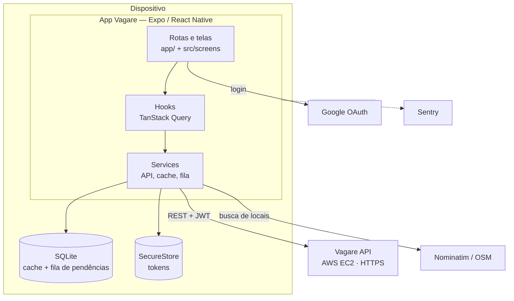
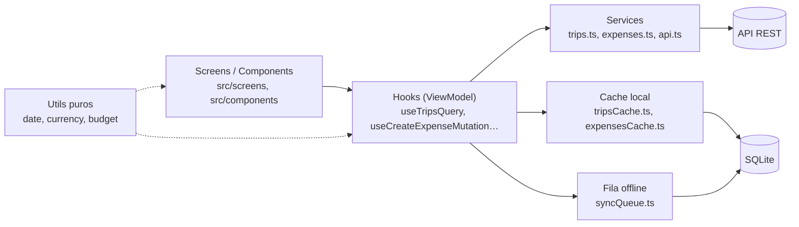
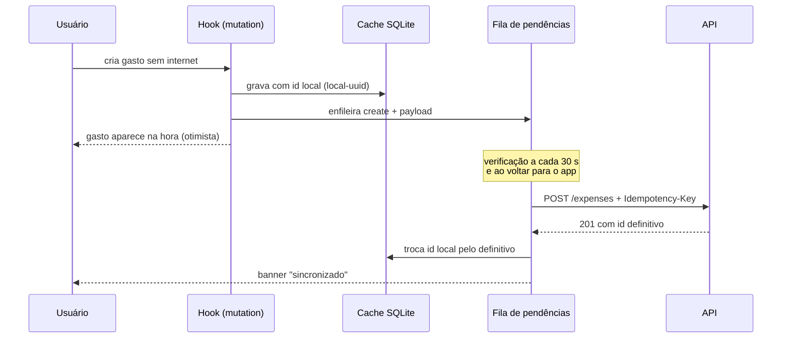

# Arquitetura do App

O app segue uma arquitetura em camadas próxima de **Clean Architecture / MVVM**: telas só renderizam, hooks fazem o papel de ViewModel e services isolam API, banco local e sincronização.

## Visão geral (C4 — containers)

## Camadas

| Pasta | Papel | Regra |
|---|---|---|
| `app/` | Rotas do Expo Router | Só monta a tela e passa parâmetros |
| `src/screens/` | Telas e componentes específicos de cada tela | Sem chamada direta à API |
| `src/components/` | Componentes reutilizáveis (Button, Input, ConfirmModal, banners) | Sem regra de negócio |
| `src/hooks/` | Queries e mutations do TanStack Query, estado de tela | Única ponte entre UI e services |
| `src/services/` | Cliente HTTP, cache SQLite, fila de sincronização, monitoramento | Sem React |
| `src/contexts/` | Sessão (AuthContext) e toasts | Estado global mínimo |
| `src/utils/` | Funções puras (datas, moedas, orçamento, política de senha) | 100% testáveis |
| `src/theme/` | Cores, fontes e espaçamentos | Design system próprio |

## Modo offline e sincronização

- Leituras: o TanStack Query busca na API; quando falha por rede, o hook cai para o cache SQLite.
- Escritas: com rede, vão direto à API e atualizam o cache; sem rede, entram na fila.
- Transações SQLite são serializadas (`transactionQueue.ts`) para evitar transações aninhadas.
- O `Idempotency-Key` garante que um reenvio após timeout não duplique o registro na API.

## Segurança

- Access e refresh tokens no **SecureStore** (Keychain/Keystore), nunca em AsyncStorage.
- Renovação automática do token quando a API devolve 401, com uma única renovação em paralelo.
- Logout e exclusão de conta limpam caches locais e a fila.
- Sentry configurado sem dados pessoais (`sendDefaultPii: false`), identificando o usuário só pelo id.
