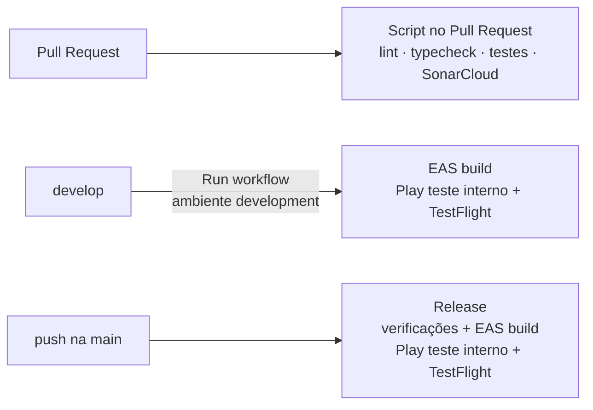

# Instalação e Deploy

## Instalar o app (avaliadores e testadores)

### Android — Google Play (teste interno)

1. Peça para ser incluído na lista de testadores (e-mail da conta Google do aparelho).
2. Abra o link de participação do teste no celular e aceite o convite.
3. Instale o **Vagare** pela Play Store a partir do mesmo link.

> Link de participação do teste interno: **(adicionar o link do Play Console → Teste interno → Testadores)**.

### iOS — TestFlight

1. Instale o app **TestFlight** pela App Store.
2. Abra o convite público ou o e-mail de convite e toque em **Aceitar**.
3. Instale o **Vagare** pelo TestFlight.

> Link público do TestFlight: **(adicionar o link do App Store Connect → TestFlight → Grupo externo)**.

O QR Code do pôster aponta para esta página.

## Rodar localmente (desenvolvimento)

Pré-requisitos: Node.js 22, Yarn 1, um celular com o build de desenvolvimento (ou emulador) e a [API rodando](https://github.com/grazielatrres/portfolio-vagare-backend/wiki/Guia-de-Contribuicao).

```bash
git clone git@github.com:grazielatrres/portfolio-vagare-mobile.git
cd portfolio-vagare-mobile/vagare-app
yarn install
cp .env.example .env
yarn dev
```

Variáveis do `.env`:

| Variável | Uso |
|---|---|
| `EXPO_PUBLIC_API_URL` | URL da API; no celular, use o IP da máquina na rede (ex.: `http://192.168.0.10:3000`) |
| `EXPO_PUBLIC_GOOGLE_CLIENT_ID` | Client ID do Google OAuth |
| `EXPO_PUBLIC_SENTRY_DSN` | DSN do Sentry (vazio = monitoramento desligado) |
| `EXPO_PUBLIC_APP_ENV` | `development` ou `production` (ambiente no Sentry) |
| `EXPO_PUBLIC_PRIVACY_POLICY_URL` | URL da política de privacidade (padrão: site da política na Vercel) |
| `EAS_PROJECT_ID` | Projeto no EAS (builds locais) |

Também é possível rodar o Metro em Docker: `docker compose up --build` dentro de `vagare-app/` (ver README).

Comandos de verificação (os mesmos do CI):

```bash
yarn lint && yarn typecheck && yarn test:coverage
```

## Pipeline de entrega



| Workflow | Disparo | O que faz |
|---|---|---|
| `pr-script.yml` | PR e push em `main`/`develop` | `scripts/pr-checks.sh` (lint, typecheck, testes com cobertura ≥ 25%) e SonarCloud |
| `release.yml` | Push na `main` (produção) ou manual (`development`/`production`, `android`/`ios`/`all`) | Verificações e depois `eas build --auto-submit` pela action `.github/actions/eas-build-submit` |

Secrets do repositório: `EXPO_TOKEN` (EAS) e `SONAR_TOKEN` (SonarCloud). As variáveis `EXPO_PUBLIC_*` de cada perfil ficam no painel do EAS (Environment variables), separadas por ambiente.

Cada build no EAS registra o commit de origem, e a versão do app é incrementada automaticamente (`autoIncrement`), garantindo rastreabilidade entre loja, build e código.
