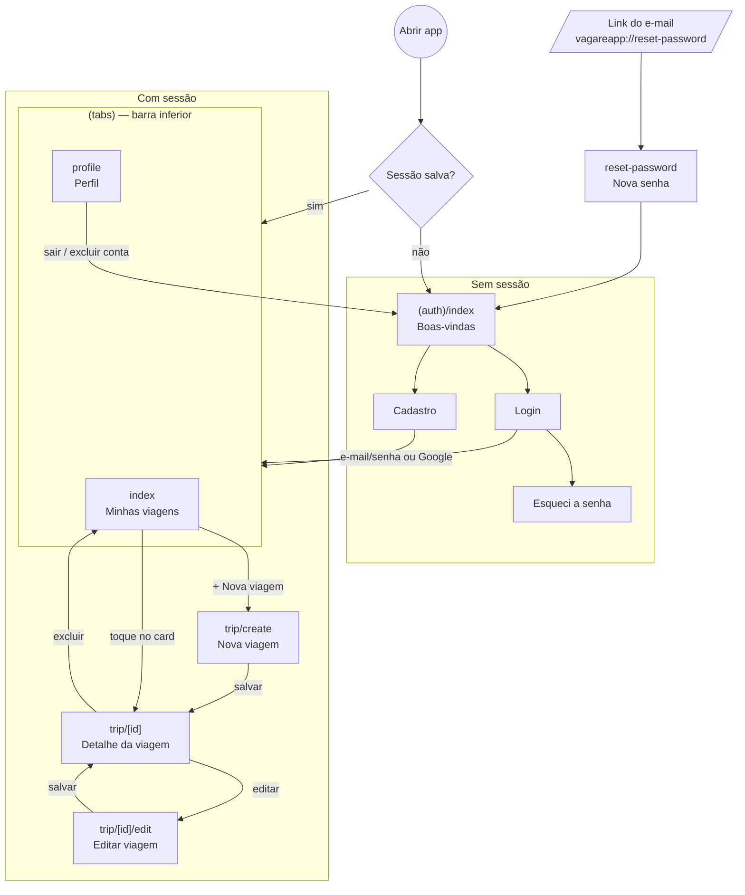

# Navegação

A navegação usa **Expo Router** (rotas por arquivo em `vagare-app/app/`). Rotas protegidas usam `Stack.Protected`: sem sessão, só as telas de autenticação ficam acessíveis; com sessão, só as telas internas.

## Telas

| Rota | Arquivo | Conteúdo |
|---|---|---|
| `/(auth)` | `app/(auth)/index.tsx` | Boas-vindas, login, cadastro, login com Google e "esqueci a senha" |
| `/reset-password` | `app/reset-password.tsx` | Nova senha a partir do link enviado por e-mail (deep link `vagareapp://`) |
| `/(tabs)` | `app/(tabs)/index.tsx` | Lista de viagens, estado vazio, banner offline |
| `/(tabs)/profile` | `app/(tabs)/profile.tsx` | Dados do usuário, estatísticas, editar perfil, política de privacidade, sair, excluir conta |
| `/trip/create` | `app/trip/create.tsx` | Formulário de nova viagem |
| `/trip/[id]` | `app/trip/[id]/index.tsx` | Detalhe da viagem com abas |
| `/trip/[id]/edit` | `app/trip/[id]/edit.tsx` | Edição da viagem |

## Abas do detalhe da viagem

| Aba | Conteúdo | Requisitos |
|---|---|---|
| Roteiro | Atividades agrupadas por dia, com período, categoria e custo estimado | RF12–RF14 |
| Calendário | Mês com marcação dos dias que têm atividades | RF15 |
| Clima | Previsão diária do destino; aviso quando sem conexão | RF16, RN08 |
| Orçamento | Orçamento, gastos, saldo e detalhamento por categoria | RF17–RF20 |
| Info | Voos e hospedagens agrupados por tipo | RF21–RF24 |
